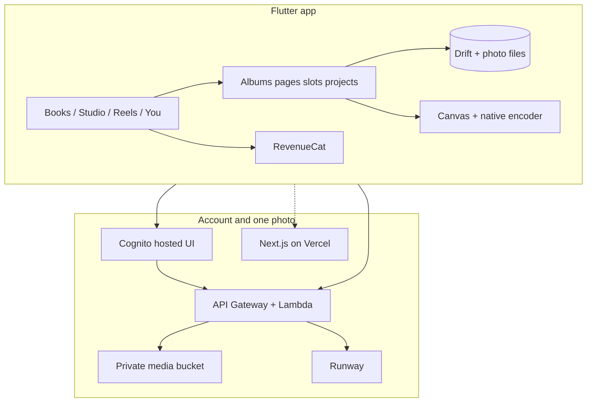
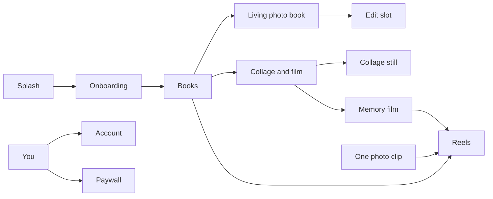

# Memory Book — System Design

**Status:** living document  
**Product:** Memory Book (`memory_book/`) — Flutter iOS + Android  
**Store framing:** Memory Book. iOS updates the live Memory Collage listing. Android is a new Play listing.  
**Principle:** a living photobook that also exports collages and reels. Photos stay on-device until the user exports, signs in, or spends an AI credit.

This document is the map. The publishable architecture notes live next to it. Each one stands alone if you lift it into a journal or onto Medium.

- [Sign-in without a login wall](features/authentication.md)
- [Purchases that follow the account](features/revenuecat.md)
- [A book, not a gallery](features/photo-album.md)
- [Collage as a canvas](features/collage.md)
- [A film from stills, encoded on the phone](features/memory-film.md)
- [A website that is only the front door](features/web.md)
- [One photo, one clip](features/ai-video.md)

Operators still use [the backend notes](../../docs/BACKEND.md) for deploy commands. Those notes are not the essays. Pair the map with [PRODUCT_ROADMAP.md](PRODUCT_ROADMAP.md).

---

## 1. Product thesis (engineering implications)

Stores already have collage makers (Canva, Picsart) and editors (CapCut, InShot). The differentiator is **opening memories like a physical album**, then branching into still export, film, and (later) generative extras.

Implications:

- The page-turn and paper materials are core product, not chrome.
- Image/video pipelines must be **canvas-rendered and encoded**, never window screenshots.
- v1 is **local-first**. Accounts, cloud, and AI vendors are additive and optional.
- Never put vendor API keys in the client. AI always goes through our proxy.

---

## 2. Current vs target

| Layer | Shipped | Still open |
| --- | --- | --- |
| Client | Flutter, Riverpod, go_router, Drift. Tabs: Books, Studio, Reels, You | Crash reporting, richer type, reduce-motion |
| Identity | Cognito email, plus Apple and Google through the hosted UI. See [authentication](features/authentication.md) | Durable user row in a database |
| Entitlements | RevenueCat when a public SDK key is set. Release builds do not fake a purchase. See [RevenueCat](features/revenuecat.md) | Signed webhook, credit packs |
| Photos | Relative sandbox paths, one-page reader, spread, crop and zoom. See [photo album](features/photo-album.md) | Face-aware crop, original asset ids |
| Collage | Normalized templates, freeform, canvas export. See [collage](features/collage.md) | More paper textures |
| Film | Native H.264, upright stills, music mix, Reels shelf. See [memory film](features/memory-film.md) | Scene-matched audio on AI clips |
| AI | API proxy to Runway. One photo, one credit. See [AI video](features/ai-video.md) | Neon ledger, optional sound model |
| Web | Next.js on its own Vercel project. See [web](features/web.md) | Store URLs when the listings are live |

The Swift/iOS tree at the repo root is **reference only** (template math, filters, bundled scores). Do not port screenshot export or the old video god-view.

---

## 3. High-level architecture

```
  +--------------------------- phone -------------------------------+
  |  Books        Studio         Reels            You               |
  |  Drift albums   collage        films + clips    account         |
  |  photos/        PictureRecorder  AVAssetWriter  Cognito tokens  |
  |                 freeform         MediaCodec     RevenueCat      |
  +--------+--------------+------------------+----------+----------+
           |              |                  |          |
           |              |                  |          |  privacy, terms, support
           |              |                  |          v
           |              |                  |     Next.js on Vercel
           |              |                  |     (no photos, no tokens)
           |              v                  v
           |         native encoder     system share sheet
           |
           |  only when a credit is spent
           v
  +---------------------- account and one photo -------------------+
  |  Cognito hosted UI                                              |
  |    email  USER_PASSWORD_AUTH                                    |
  |    Apple / Google  ->  memorybook://auth  ->  tokens            |
  |                                                                 |
  |  API Gateway -> Lambda (FastAPI)                                |
  |    Bearer id token                                              |
  |    POST /v1/ai/video  ->  Runway Gen-4 Turbo (photo)            |
  |                          or Gen-4.5 (words only)                |
  |    GET  /v1/ai/jobs/{id}                                        |
  |    POST /v1/billing/revenuecat   (answers, does not grant)      |
  |                                                                 |
  |  private S3 for that one uploaded image                         |
  +-----------------------------------------------------------------+
```

Each box is written out with libraries and source in the essays linked above. GitHub will also render this Mermaid view of the same split:



### 3.1 Client stack (locked)

- **UI:** Flutter 3 / Dart 3, custom paper-and-film theme (`lib/core/theme`)
- **State:** Riverpod
- **Nav:** go_router. Tabs are Books, Studio, Reels, and You. Full-screen routes cover the book, collage, film studio, paywall, account, and AI lab
- **DB:** Drift (`lib/data/db/app_database.dart`)
- **Photos:** `photo_manager` + `image_picker`; copies persist under app documents as relative paths
- **IAP:** `purchases_flutter`. A release build with an empty SDK key does not unlock locally
- **Share / save:** `share_plus`, `gal`
- **Video encode:** MethodChannel `memory_book/video_encoder` (not FFmpeg)
- **Auth:** Cognito. Email is `USER_PASSWORD_AUTH`. Apple and Google return through `memorybook://auth`
- **Web:** `apps/web`, deployed on its own Vercel project

### 3.2 Backend

The account, the credit call, and the one photo sent for a clip:

- **Auth:** Cognito user pool. Apple and Google are identity providers on that pool. Essay: [authentication](features/authentication.md)
- **API:** FastAPI on Lambda, behind API Gateway. `POST /v1/ai/video`, `GET /v1/ai/jobs/{id}`, `POST /v1/billing/revenuecat`
- **Ledger:** in-memory until Neon. A cold start forgets credits and jobs
- **Secrets:** Runway and the social-provider secrets stay on the stack. The phone holds a public Cognito client id and, when set, a public RevenueCat SDK key
- **Site:** Next.js. Essay: [web](features/web.md)

---

## 4. App surfaces



| Surface | Responsibility |
| --- | --- |
| Shelf | Local albums as physical covers; create book |
| Book reader | One page by default, two-page spread on demand, slot crop |
| Collage studio | Templates and freeform, canvas render, watermark for free |
| Video studio | Memory film: aspect, filter, transition, music |
| Reels | Finished films and AI clips, share and delete |
| Paywall | Premium: no watermark, all templates, unlimited books |
| You | Account, Premium, weekly reminder, privacy, terms, support, version |
| AI | Spend a credit on one chosen photo |

---

## 5. Data model

### 5.1 Drift tables (now)

- **Albums** — title, `themeId`, cover path, date range
- **BookPages** — `albumId`, index, `layoutId`
- **PhotoSlots** — image path, caption, pan/zoom (`scale`, `offsetX/Y`), `filterId`, `showDate`
- **CollageProjects / CollageItems / CollageTexts**
- **VideoProjects / VideoClips**
- **AppKvEntries** — onboarding, local premium flag (dev only)
- **CreditEvents** — signed integer deltas (client cache)
- **AuthSessions** — provider, subject, email (empty until login)

Photos are **files**, not BLOBs. DB stores paths into `ApplicationDocuments/photos/`.

### 5.2 Target additions

- `originalAssetId` + `creationDate` on slots (library round-trip, auto-albums)
- `sticker` / `textStyle` on pages and collages
- `exportJobs` — local queue for long encodes + notification when done
- `remoteJobId` on AI jobs
- Soft-delete / trash for albums (30-day)

### 5.3 File layout (device)

```
Documents/
  photos/{uuid}.jpg          # persisted user media
  projects/{id}/             # optional project packages later
tmp/mb_export/               # stills and frame sequences
tmp/reel_{id}/               # flip-reel frames then deleted
```

Do **not** wipe the whole temp directory (bug in the old Swift video path).

---

## 6. Domain: images

### 6.1 Ingest

1. System picker or PhotoKit / Photo Picker (`photo_manager`)
2. Decode, downscale long edge (today 2400px), JPEG persist
3. Respect **limited library** (iOS) and Android Photo Picker partial access
4. Never require full-library access for “add one photo”

### 6.2 Editing (non-AI)

| Capability | v1 | Target |
| --- | --- | --- |
| Add / replace / delete in a slot | Yes | Yes |
| Pan / zoom crop in cell | Partial (stored offsets) | Interactive crop + face-aware default |
| Filters | ColorMatrix set | Same + film LUTs |
| Captions | Yes | Fonts, ink color, date sticker |
| Backgrounds | Solid | Paper textures, gradients, custom image |
| Stickers / washi / handwriting | No | Yes, premium pack |
| Adjust (light, contrast, crop, rotate, straighten) | No | Photo editor sheet |
| Heal / object remove | No | AI, credit or premium |

### 6.3 Collage

- Templates are **normalized 0–1 frames** (`lib/domain/collage_templates.dart`), ~30 curated (not empty NxN spam)
- Free vs premium IDs in `AppConfig.freeCollageTemplateIds` — gate in UI **and** export
- Render: `CollageRenderer` + `ui.PictureRecorder` at Low/Medium/High (720 / 1080 / 2160)
- Formats: JPEG, PNG, HEIC (iOS ImageIO; Android falls back to JPEG today)
- Free export draws watermark in pixel buffer, not as a view overlay someone can screenshot around easily (still not DRM)

### 6.4 Living photo book

- Cover themes: leather, linen, Polaroid, wedding, baby, travel
- Layouts: full, two, three, polaroid, scrapbook, blank
- Page-turn: perspective `Matrix4` + haptics (`PageCurlSpread`)
- Spread export: off-screen `BookPainter`
- Flip reel: paint cover + spreads + turn frames → native `encodeFrames` 1080×1920

Target feel: paper grain, foil titles, optional page-rustle, not a PDF pager.

---

## 7. Domain: video

### 7.1 Memory film (non-AI)

Inputs: ordered stills, aspect (`9:16` / `1:1` / `16:9`), seconds per still, filter, transition, optional audio.

Pipeline:

1. Flutter prepares image paths + music (bundled `assets/audio/1.mp3`–`11.mp3` materialized to tmp, or user file)
2. Channel `encodeSlideshow` / `encodeFrames`
3. **iOS:** `AVAssetWriter` H.264 + optional `AVMutableComposition` audio mix (`ios/Runner/AppDelegate.swift`)
4. **Android:** `MediaCodec` plus `MediaMuxer`, including the audio mix (`MainActivity.kt`)
5. Preview `video_player` → `gal` save and/or `share_plus`

The essay is [A film from stills](features/memory-film.md). Transitions are encoded into the file. The Reels tab is where the finished mp4 lives.

### 7.2 Album → Reel

Ken Burns-ish stills of spreads + page-turn frames, 12 fps class, 9:16, share as Reels/TikTok/Shorts.

### 7.3 AI video

The essay is [One photo, one clip](features/ai-video.md). The phone posts one image to our API. The API calls Runway and returns a job the phone polls. Gen-4 Turbo does not take an audio field. The clip is filed on the Reels tab.

Account is optional until that call. The id token is `Authorization: Bearer`.

**Do not lead** with text-to-video. Words alone are a different, more expensive request. The product is their photo, moving.

---

## 8. Monetization (RevenueCat)

The essay is [Purchases that follow the account](features/revenuecat.md).

Entitlement: `premium`. Products: `com.memorycollage.premium.annual`, `com.memorycollage.premium.monthly`, and the legacy `com.memorycollage.premium`. After sign-in, `Purchases.logIn` uses `provider:subject`. A release build does not unlock locally. The webhook route exists and does not grant credits until it can verify a signature against a durable ledger.

## 9. Identity

The essay is [Sign-in without a login wall](features/authentication.md).

Login is not required to open a book. It is required to spend a credit. Email, Apple, and Google all end as Cognito tokens. Sign-out clears the session, not the albums.

## 10. Notifications

### 10.1 Local (no account)

- Export finished (long reel encode in background)
- “Add this week’s photos” gentle reminder (opt-in)
- Anniversary / “this day in your book” from EXIF dates (opt-in)

### 10.2 Remote (after backend)

- AI job ready
- Credit pack receipt
- Family shared album invite (much later, high privacy bar)

Implementation sketch: `flutter_local_notifications` first; Firebase/APNs only with a privacy nutrition-label update. Hard opt-in. No engagement spam.

---

## 11. Sharing and saving

| Output | Save | Share |
| --- | --- | --- |
| Page / spread still | Photos | System share sheet |
| Collage | Photos | Share sheet |
| Film / reel MP4 | Camera roll (`gal`) | Share sheet (Reels, Messages, Files) |
| Whole book | Later: PDF / print partner / web flipbook link | After backend |

Watermark on free stills and consider a short end-card on free reels.

---

## 12. Privacy, permissions, security

v1 store answers: **no tracking, no collected photos, no required account.** See [store/PRIVACY.md](../store/PRIVACY.md).

| Permission | Why |
| --- | --- |
| Photo library read | Place pictures on pages |
| Photo library add | Save exports |
| Camera optional | Capture a new page |
| Notifications | Only after opt-in |
| Network | IAP, account, and the one photo sent for a clip |

- ITSAppUsesNonExemptEncryption = false until we add custom crypto for cloud
- AI: images leave device only on explicit credit spend; say so in the confirmation sheet
- No third-party analytics that fingerprint photos
- Prefer PostHog self-hosted or TelemetryDeck; Sentry for crashes without PII

---

## 13. Quality bar (world-class)

1. **First 10 seconds:** open a book, turn a page, want to show someone.
2. Every export is a real raster/encode; golden tests for template frames and watermark.
3. Limited photo access is a first-class path, not an error toast.
4. Encode failures surface a retry, never a silent toast that claims “saved.”
5. Page-turn 60 fps on mid-range Android; budget a curl spike every release.
6. Accessibility: Dynamic Type on chrome, reduce-motion = fade instead of curl.
7. Background export + notification so a 40-page reel does not freeze the UI.

---

## 14. Repository map

```
memory_book/          Flutter app
  docs/features/      the essays linked above
  lib/                book, collage, film, reels, auth, paywall
  ios/ android/       native encode
apps/web/             Next.js site
services/api/         FastAPI
infra/lite/           Cognito, API Gateway, Lambda, private bucket
```

Root `MemoryCollage/` Swift app: reference for layout math. Do not ship it.

Store version for this revamp is **2.0.0 (6)** on both platforms, above the live Memory Collage build 1.0.1 (5). iOS Release keeps `com.playingview.mobigaurav.MemoryCollage`. Play is `com.playingview.mobigaurav.memorybook`. Profile stays on `com.playingview.mobigaurav.memoryBook` so a desk install does not replace the store app.

---

## 15. Still open

- Neon for credits and jobs. The Lambda ledger forgets them on a cold start.
- RevenueCat webhook signature, then grants. The route currently accepts the call and writes nothing.
- Sound on an AI clip that matches the picture. Gen-4 Turbo does not do that. A Memory film uses music the person chose.
- Optional encrypted album backup. Signing in does not upload the shelf.

The book on the phone is still the product. The essays describe the pieces around it. They are written so a section can be published without the deploy notes.
